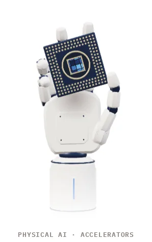

<a href="https://rucinski.ai">
  <picture>
    <source media="(prefers-color-scheme: dark)" srcset="./assets/hero-dark-v2.webp" />
    <source media="(prefers-color-scheme: light)" srcset="./assets/hero-light-v2.webp" />
    
  </picture>
</a>

<a href="https://rucinski.ai">
  <picture>
    <source media="(prefers-color-scheme: dark)" srcset="./assets/bento-dark-v2.webp" />
    <source media="(prefers-color-scheme: light)" srcset="./assets/bento-light-v2.webp" />
    
  </picture>
</a>

 

<picture>
  <source media="(prefers-color-scheme: dark)" srcset="./assets/hand-dark-v2.webp" />
  <source media="(prefers-color-scheme: light)" srcset="./assets/hand-light-v2.webp" />
  
</picture>

### Selected work

- **FTerViT** — NeurIPS 2026 ([paper](https://arxiv.org/abs/2605.21171) · [demo](https://szymonrucinski-ftervit.static.hf.space))
- **Open models & demos** — [krakowiak-7b](https://huggingface.co/szymonrucinski/krakowiak-7b) · [Skryba-v1](https://huggingface.co/szymonrucinski/Skryba-v1) · [AiRoll](https://szymonrucinski-airoll.static.hf.space)

[rucinski.ai](https://rucinski.ai) · [Hugging Face](https://huggingface.co/szymonrucinski) · Find me on LinkedIn

 
